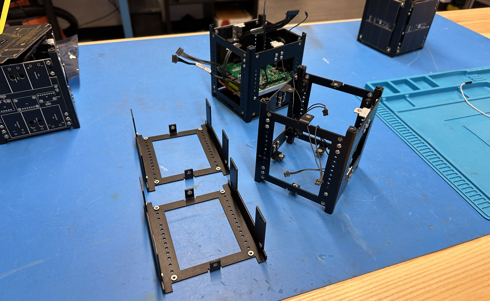
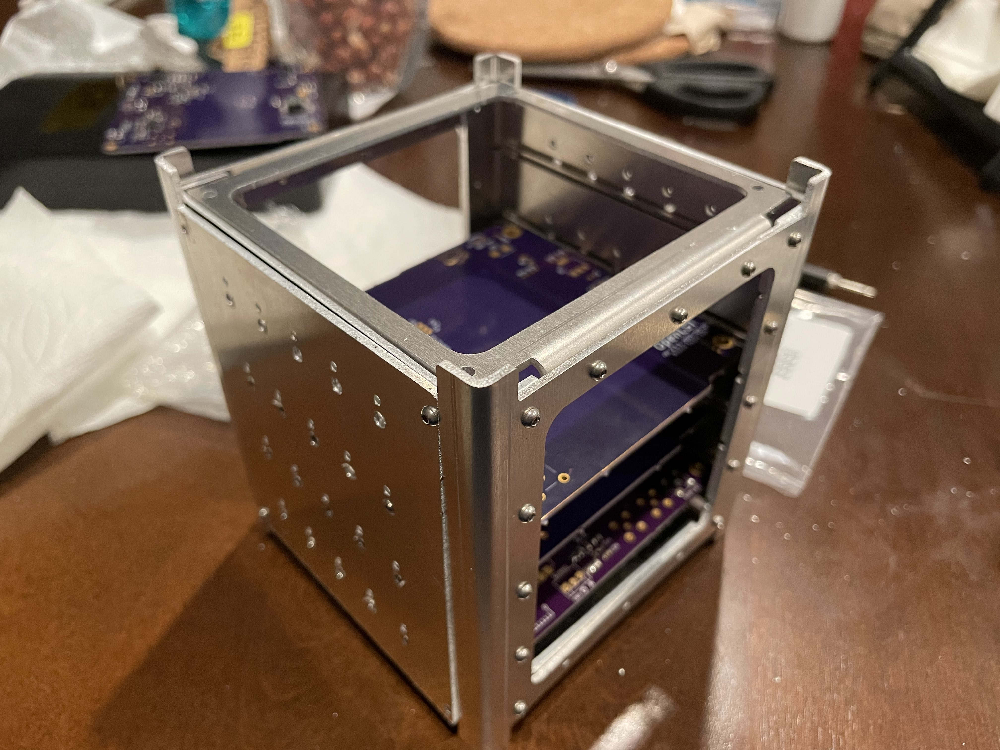
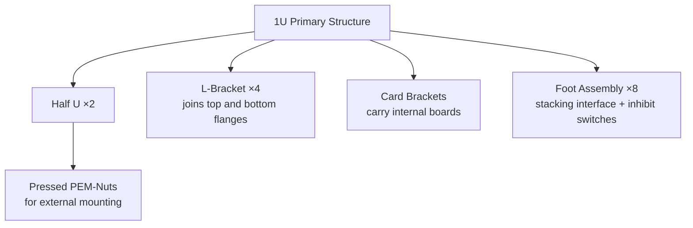
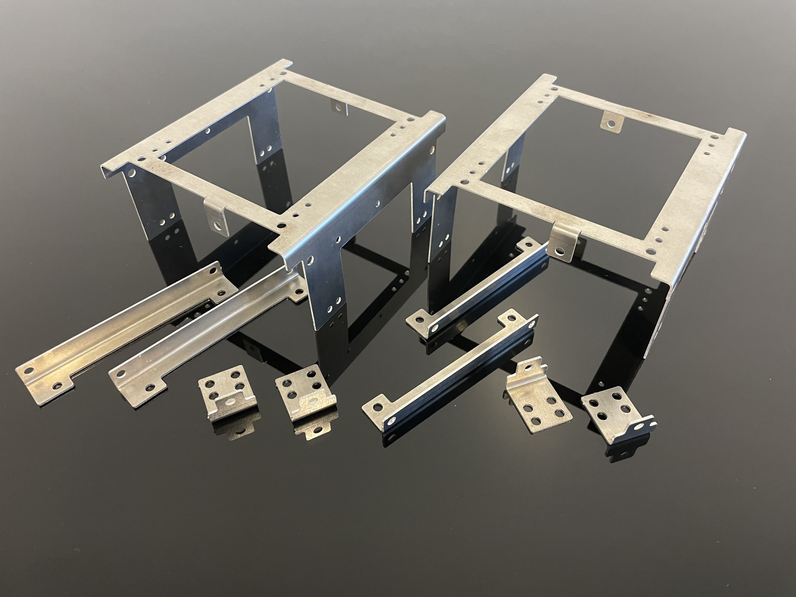
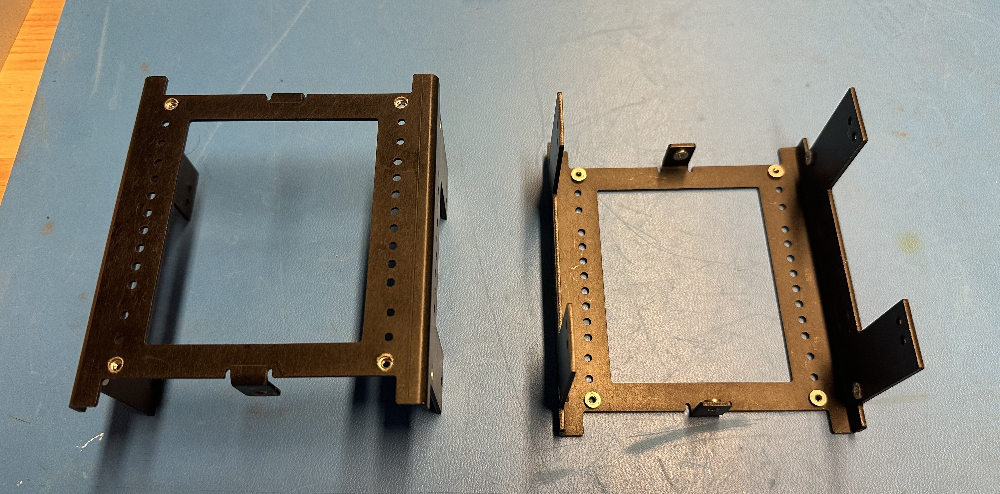
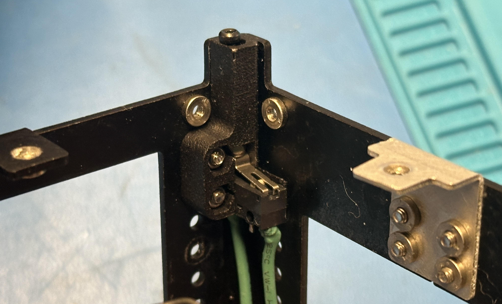

# Overview

Figure 1: The PROVES Kit Structure

!!! Find the Structure on Github [Here!](https://github.com/proveskit/1U_structure)

The PROVES kit "1U" structure was designed around maximum customizability. With sixteen unique positions, several boards can fit inside to fulfill most mission requirements. The structure is laser cut, bent, and anodized 5052 Aluminum sheet metal, and is even strong enough to withstand the weight of a fully grown adult! Primary holes on the structure not joined with a bracket or hardware internally contain pressed PEM-Nuts for easy external mounting. The main structure was designed to be two separate halves that are joined together by brackets and Printed Circuit Boards.

??? note "A Structural Sidebar"
    The sheet metal structure that we now know and love as a part of the PROVES kit was designed by Gavin James after the Yearling rescope. What many people don't know though is that our sheet metal lineage actually began much earlier than that with multiple prototype structures being designed by Bronco Space Co-Founder and one time **CAD God** Ben Narita. 

    
    
Figure B1: Ben and Kelsey with the Proto Structure in the El Monte Branch!

    This design was really interesting, because it tried to emulate the OreSat card cage system with significantly less parts and greatly simplified manufacturing. The idea was to use a slotted sheet metal sandwich structure to create a clinching force when set screws were threaded in to deform an inner layer. It could have been pretty cool! We never followed through with trying to make it work long term though, since the much simpler half-u style structure won out in the long run. 

    
    
Figure B2: A Close Up of the Proto Structure

   
## The Primary Structure
The primary structure of the satellite is usually considered the parts of the physical structure that will carry load during the launch environment and define the first resonant mode. 

Figure 2: The Raw PROVES Kit Structure Components

| Component | Qty | Material | Recommended Fasteners |
| --------- | --- | -------- | --------------------- |
| Half U | 2 | 1.6mm 5052 formable aluminum sheet metal | CLS-M2.5-2 self-clinching nuts, 18-8 stainless steel M2.5x5mm T8 Torx panhead |
| Brackets | 4 L-brackets plus card brackets | 1.6mm 5052 formable aluminum sheet metal | CLS-M2.5-2 self-clinching nuts, 18-8 stainless steel M2.5x5mm T8 Torx panhead |
| Feet assemblies | 8 | PA-12 nylon, MJF or SLS 3D printed | |

!!! warning 
    When selecting fasteners do not use Zinc Plated. Although the risk is low, use of Zinc Plated Fasteners for flight can cause issues with your launch provider. See this [NASA site](https://nepp.nasa.gov/whisker/reference/tech_papers/Brusse2003-Zinc-Whisker-Awareness.pdf) for more details. 

Figure 3: The Half U's

### Feet Assemblies 
The structure also maintains mounting holes for feet on each structure half, and each 3D printed foot can house switches for inhibiting the satellite. When the satellite is in the deployment pod on its way to space, it needs to remain off until it has been deployed. While the satellite is in the pod, its feet are covered, and thus embedded switches can be depressed to inhibit the satellite. After the satellite is deployed, with nothing depressing the switches, the satellite can spring to life. 

Figure 4: The Current Footswitch Design

Two foot designs exist. We have no coined term for the current one, so we call it "BroncoSat Style" because we first used it on BroncoSat-1. The older one we call "BIRDS Style" because it is used by the Japanese BIRDS Open Source CubeSat Bus.

| | BroncoSat Style (current) | BIRDS Style (older part number) |
| --- | --- | --- |
| Switch | Mechanical limit switch wired Normally Closed (NC). Throws open when depressed | SDS005R microswitch |
| Actuation | M2 screw plunger through the foot opens the circuit when depressed. The switch's leaf spring rejects the plunger, a nut retains it | Depressed directly |
| Assembly | | An incredible pain to assemble, and the switch can be burned through by the burn wire circuit |
| Manufacturing | 3D printed, about $1 per foot | Can be CNC machined, about $54 per foot |
| Use when | Default | You must optimize internal volume, need extra strength, or the launch provider requires metal touch points |

## Peripheral Hardware
A Remove Before Flight ("RBF") switch and pin can also be added to the satellites top cap PCB for inhibitting the satellite as it is transported and placed in the deployment pod. The bracket that is mounted to the top cap PCB can house the switch and the top cap PCB features a hole for dropping a pin into place to depress the RBF switch.

Figure 5: Taking the Jig for a Spin

The Jig is also a valuable piece of hardware for squaring up the structure during assembly. We recommend 3D printing one on a printer known to have good dimensional accuracy and using it throughout the build and intergration process.

## Expansion & Varients
The PROVES kit can be expanded to stack structures to meet larger satellite requirements (such as a "3u"). Special feet have been designed for this very concept to help join the structures together. This design implementation is completely experimental and has not ever been vibration tested or qualified for space. With the PROVES kit design being open-source, the concept could be tested and experimented with by anyone to further improve the community using the designs.

For fun, Adam Elsharhawy has also been working on a carbon fiber varient of the structure! 

Figure 6: Carbon Fiber!

## Qualified for space

| Test | Result |
| ---- | ------ |
| Random vibration (earlier version of the kit) | Survived 20 g RMS |
| Static load | Withstands the weight of an adult |
| Thermal cycling | Survived intense cycling |
| Flight | Two mission successes |

After two mission successes, the PROVES kit structure can easily qualify for space.
