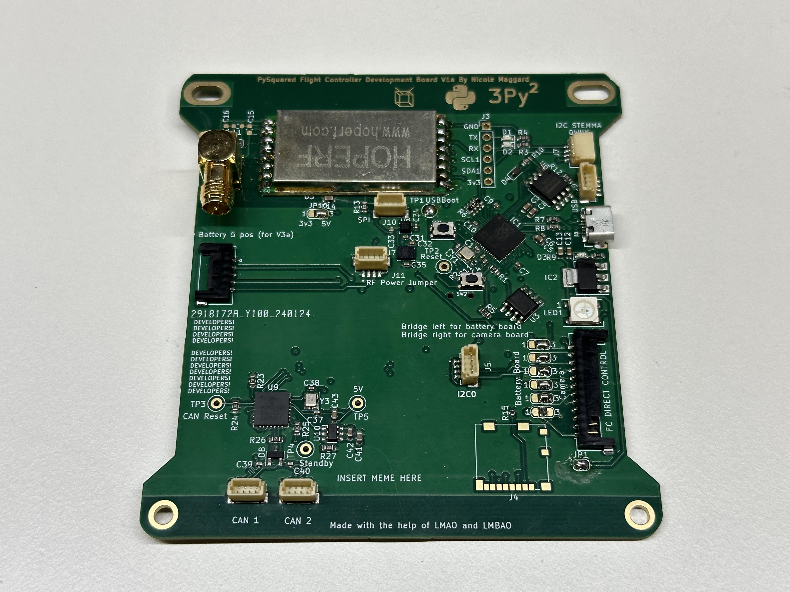
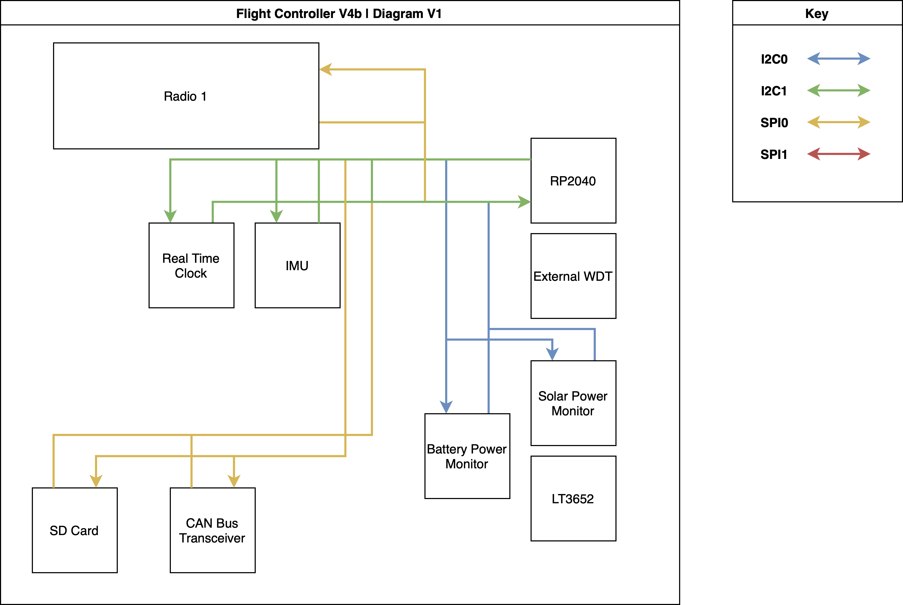
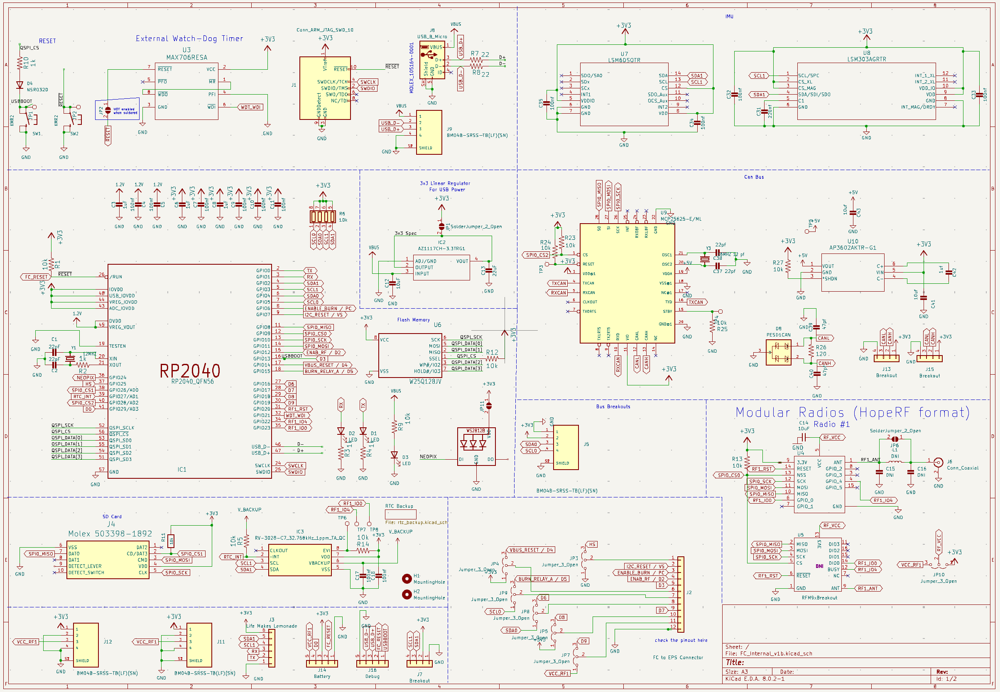
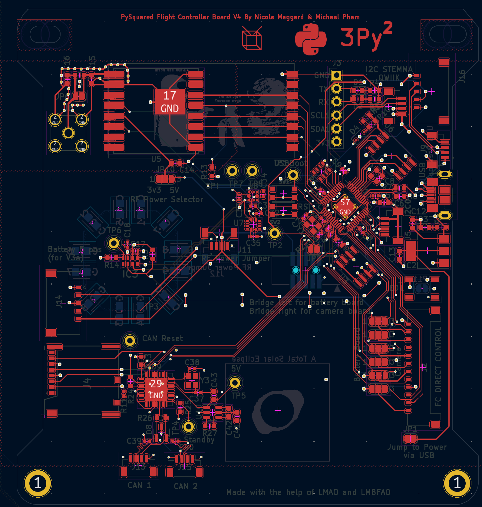
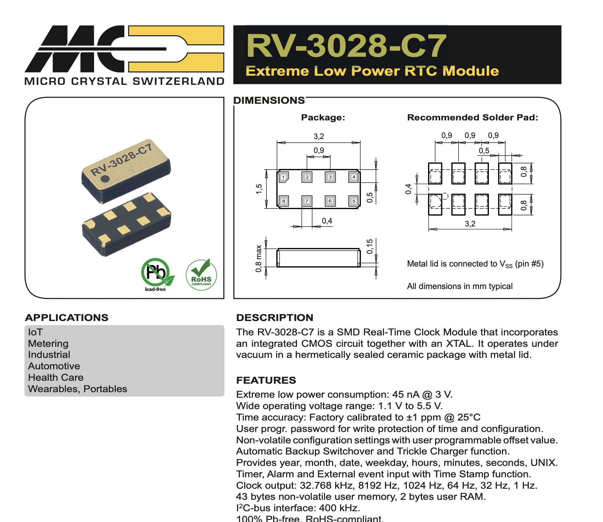
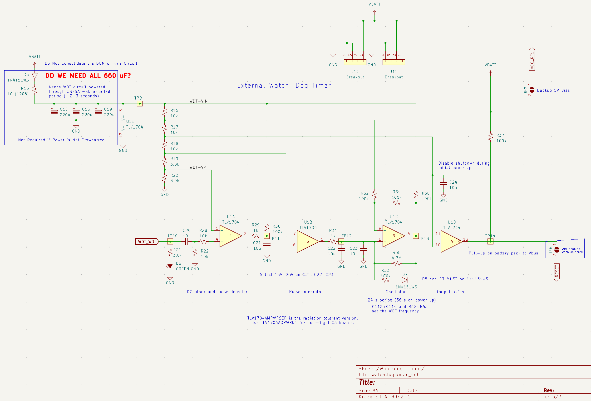
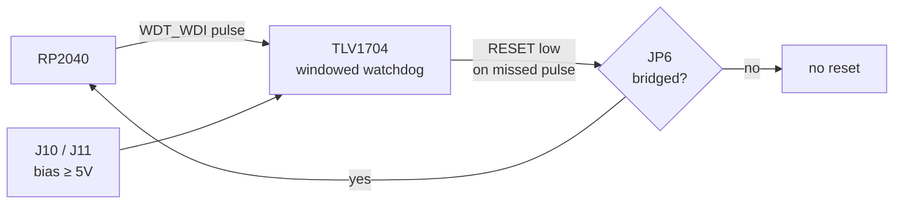

# Overview

Figure 1: The Internal Flight Controller Board

The PROVES Kit Flight Controller is part of the PySquared architecture that harbors all of the satellites core operations. There are two variants of the Flight Controller, an internal variant and an external variant.

| Version | Flights | Status |
| ----------- | ----------- | ----------- |
| V0 | Unflown | Not Supported |
| V1 | Pleiades - Yearling, Pleiades - Squared | Legacy Support |
| V2 | Unflown | Unsupported |
| V3 | Unflown | Legacy Support |
| V4a (aka V1a Internal) | Unflown | Supported |
| V4b | Unflown | Supported |
| V4c | Pleiades - Orpheus | Supported |
| V5 | Unflown | In Development |

## Getting Started
!!! note 
    These instructions are valid for Flight Controller Boards V1a (Internal), V4a, V4b. V4c. 

Set the solder jumpers for your configuration first:

| Jumper | Function | Setting |
| ------ | -------- | ------- |
| `JP1` | Power the board from USB (5V V_Bus through the AZ1117CH 3.3V regulator) | Bridge when no battery board is connected |
| `JP10` | V_RF radio supply voltage selector | Center pad to **left** for 3.3V, to **right** for 5V. Smaller, more square radio modules take 3.3V; larger, more rectangular modules take 5V |
| `JP6` | Routes the watchdog `RESET` signal to the RP2040 | Bridge to arm the watchdog (see [Using the Watchdog Circuit](#using-the-watchdog-circuit)) |

1. Solder on the Radio Module and an antenna or compatible SMA connector as needed.
2. Plug in a USB Cable!
3. If a CircuitPython file system does not appear, you may have to flash the board with firmware. 
    - The most up to date firmware can be found [here](https://github.com/proveskit/flight_controller_board/tree/main/Firmware). 
    - If you have never installed CircuitPython before you can find instructions [here](https://learn.adafruit.com/welcome-to-circuitpython/installing-circuitpython).
4. Continue to the [PROVES Quick Start Guide](https://docs.proveskit.space/en/latest/quick_start/proves_quick_start/) for more!

## Utilized Parts

| Function | Part | Interface | Boards | Notes |
| -------- | ---- | --------- | ------ | ----- |
| Microcontroller | Raspberry Pi RP2040 | USB 1.1, PIO, SPI, I2C | All | Dual-core ARM Cortex-M0+ at 133 MHz, 264 KB SRAM, up to 16 MB off-chip flash. CircuitPython or C++ (PicoSDK) |
| UHF radio | RFM98PW | SPI | All | 435 to 438 MHz amateur satellite band. Hybrid footprint also fits an RFM95 for the 915 MHz ISM band |
| Real time clock | Micro Crystal RV-3028-C7 | I2C, interrupt pin | V4b and later | UNIX time plus calendar counters. Pin alarms wake the RP2040 or schedule beacons. Same IC as the OreSat C3. [Datasheet](https://www.microcrystal.com/fileadmin/Media/Products/RTC/Datasheet/RV-3028-C7.pdf), [application guide](https://www.microcrystal.com/fileadmin/Media/Products/RTC/App.Manual/RV-3028-C7_App-Manual.pdf) |
| Antenna deployment sensor | VL6180 LiDAR | I2C | V3 and earlier | Moved to the battery board as of V4 to work with the burn wire circuit |
| Mass storage | Molex micro SD card reader | SPI | All | Cards up to 16 GB under CircuitPython. [SanDisk Industrial](https://www.mouser.com/datasheet/2/669/SanDisk_Industrial%20Grade%20SD%20%20MicroSD%20Product%20Brief-805940.pdf) recommended for flight |
| Watchdog | MAX706RESA | `WDT_WDI`, `RESET` | V4b and earlier | Borrowed from the PyCubed |
| Watchdog | TI TLV1704 (or TLV1704-SEP) | `WDT_WDI`, `RESET`, `J10`/`J11` bias | V4c and later | Windowed comparator watchdog. The -SEP (Space Enhanced Part) variant is radiation *tolerant*, not *hardened*. [Datasheet](https://www.ti.com/lit/ds/symlink/tlv1704.pdf) |
| 3.3V regulator | AZ1117CH | 5V V_Bus in, 3.3V out | All | Linear. Powers the board from USB when `JP1` is bridged |

#### V4b Schematic

#### V4b Layout

### RP2040 Microcontroller
The RP2040 was selected for use in the PROVES Kit thanks to its industry leading $1 price and abundance during the global chip shortage. Today we continue to use it thanks to the growing community of users worldwide. 

### RFM98PW 433 MHZ Radio Module
This module was selected based on its flight heritage on the PyCubed lineage of CubeSats.

### RV-3028-C7 Real Time Clock (RTC)

Blake from the TXST Space Lab did some cool testing to make sure that the RTC doesn't start drifting from real time in this [GitHub Issue](https://github.com/proveskit/pysquared/issues/186)

### TLV1704 Radiation Tolerant Watchdog Circuit

Starting with **FC Board V4c** and higher we swapped out the MAX706RESA with a windowed watchdog circuit based on the TLV1704 comparator network from Ti.

#### Using the Watchdog Circuit

| Parameter | Value |
| --------- | ----- |
| Expected `WDT_WDI` pulse interval | 26 s |
| Pulse interval on cold start | 54 s |
| Action on missed pulse | `RESET` pulled low |
| Bias voltage for `RESET` to assert | 5V or greater, through `J10` or `J11` |
| Path from `RESET` to the RP2040 | `JP6` solder jumper on the front of the board must be bridged |

!!! bug "V4c InspireFly Special Triggers too Fast!"
    
    A known issue for V4c InspireFly Special boards is that when powered up the WDT circuit actually triggers a reset approximately every 5s rather than the designed 26s. This was due to a BoM consolidation mistake when manufacturing the boards and will be corrected in future production runs.

    Find out more on [this GitHub Issue](https://github.com/proveskit/flight_controller_board/issues/24).

## Change Log
The change log keeps track of major differences between the various versions of the flight controller board. 

With the introduction of V4 Flight Controller Boards (also known as V1 Internal Flight Controller Boards) we moved the main flight controller from being the inside of an exterior panel to its own dedicated board on the inside of the satellite. This was done to better protect the main avionics package from thermal and radiation effects. 

| Version | Changes | Sub-variants |
| ------- | ------- | ------------ |
| V4 | Flight controller moves from an exterior panel to a dedicated internal board | |
| V4a | Layout changes and part package swaps. No fundamental functionality changed | |
| V4b | Repositioned connectors, debug Picolock added, Real Time Clock circuit added | |
| V4c | OreSat based watchdog timer circuit added to better defend against radiation upsets | `Express` (Pleiades - Orpheus), `InspireFly Special` (InspireFly) |

## Power Consumption Characterization
Notes on the FC board power consumption and attempts to reduce power consumption through underclocking the MPU are noted in [this GitHub Issue](https://github.com/proveskit/flight_controller_board/issues/22).

## Known Issues
- Microcontroller and radio possibility have a high suspectibility failure due to thermal and radiation effects. In a future version imrpoved placement and redundancy will be implemented to protect these core components from those effects.  
- Antennas are very annoying to install and may also be suceptible to failure due to thermal effects. 

### V5 Dev Board Errata

| Item | Symptom | Status |
| ---- | ------- | ------ |
| LM2901 | Needs the B variant for open collector use. Enabling the watchdog load switch hard resets the board | Open |
| SPI0 / SPI1 | Both use the same hardware peripheral | Open |
| Load switches | Go into FAULT when connected to the solar panel boards. Panels run without overcurrent on an independent supply, and removing the current limit resistor had no effect | **Solved.** Current limit is pulled up instead of down |
| `MUX_RESET` | Not connected | Open |
| Solar face power cycling | A quick power cycle latches the TCA I2C bus low. Requires an unplug and replug | Open |
| Fire Deploy A / B | Need to be connected to burn | Open |
| 555 timer reset circuit | Creates a boot loop when used | Open |

## Troubleshooting

## Serial Number Tracking 

| Serial | Radio | Watchdog | Sent to |
| ------ | ----- | -------- | ------- |
| FCV4c_0006 | RFM98PW | | Texas State |
| FCV4c_0008 | RFM98PW | | SlugSat |
| FCV4c_0009 | RFM98PW | | Northeastern |
| FCV4c_0010 | RFM98PW | | InspireFly |
| FCV4c_0011 | RFM98PW | | InspireFly |
| FCV4c_0012 | RFM98PW | | Columbia |
| FCV4c_0016 | RFM98PW | TLV1704-SEP | InspireFly |
| FCV4c_0017 | None | | Mt. SAC |
