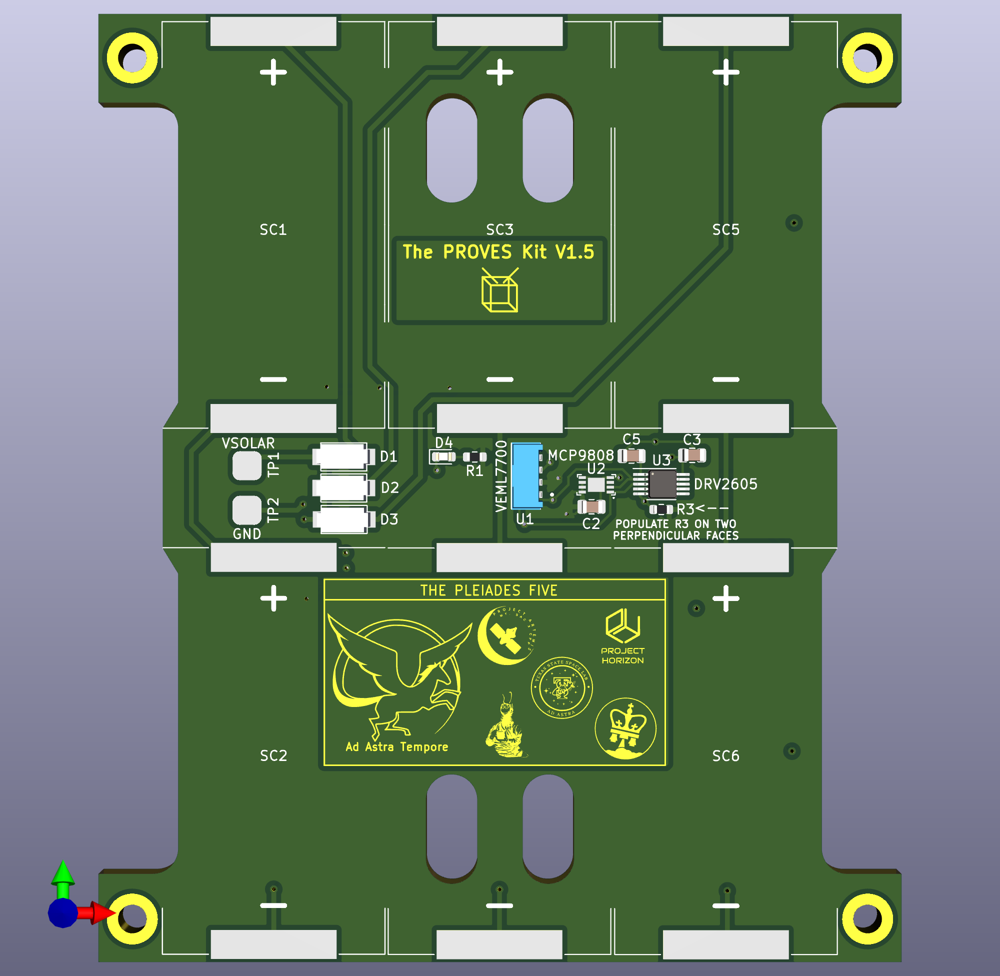

# Overview
The PROVES kit XY Solar Boards...

Figure 1: A Render of the Pleiades Five XY Solar Board

## Getting Started

!!! Find the Structure on Github [Here!](https://github.com/proveskit/solar_boards)

## Utilized Parts
Each XY solar panel implements the following elements:

| Function | Part | Qty | Interface | Notes |
| -------- | ---- | --- | --------- | ----- |
| Solar cells | AnySolar KXOB101K08TF | 6, in 2s3p | VSolar | Silicon cells under a resilient EVA film. The Stanford team validated at least 3 months in space with no noticeable degradation |
| Temperature sensor | Microchip MCP9808T-E/MC | 1 | I2C | |
| Magnetorquer drivers | TI DRV2605LDGSR haptic motor driver | | I2C | Energize the two hand drawn coils embedded in the 4-layer PCB. Low current, but enough field for detumbling |
| Ambient light sensor | Vishay VEML7700-TT | | I2C | Luminance follows the sun's angle of incidence, roughly a bell curve |
| Power indicator | Blue LED | 1 | | A great indicator that everything is powered up! |
| Connector | 5-pin Molex 1.5mm pitch Picolock | 1 | VSolar, 3.3V, GND, I2C | Positively locking. Carries power and all face sensor signals |

## Design Rationale
The goal for the these XY solar panels is to create a solar panel board that can work on any XY face of the satellite without modification. This modularity allows us to reduce the number of unique parts, simplifying integration and testing while also reducing cost in manufacturing. 

### Use of Silicon Solar Cells vs Gallium Arsenide

| | Silicon (PROVES Kit) | Gallium Arsenide (triple junction) |
| --- | --- | --- |
| Efficiency | Lower | Very high |
| Cost | Radically lower | Extremely high. The industry serves space almost exclusively because terrestrial use is unaffordable |
| Supply chain | Very robust | Space only |
| Lifetime | Unknown beyond the 3 months Stanford validated | Performance guaranteed over a 25 year mission life |
| Who flies it | Believed to be the most common chemistry in LEO today, including pretty much all Starlink satellites | Most traditional space missions |

## Known Issues
There are no known issues with the solar panels. Amanda kind of hit it out of the park on the first try! 

## Troubleshooting
