# Overview
!!! tip "Looking for the [GitHub](https://github.com/proveskit/battery_board)?"

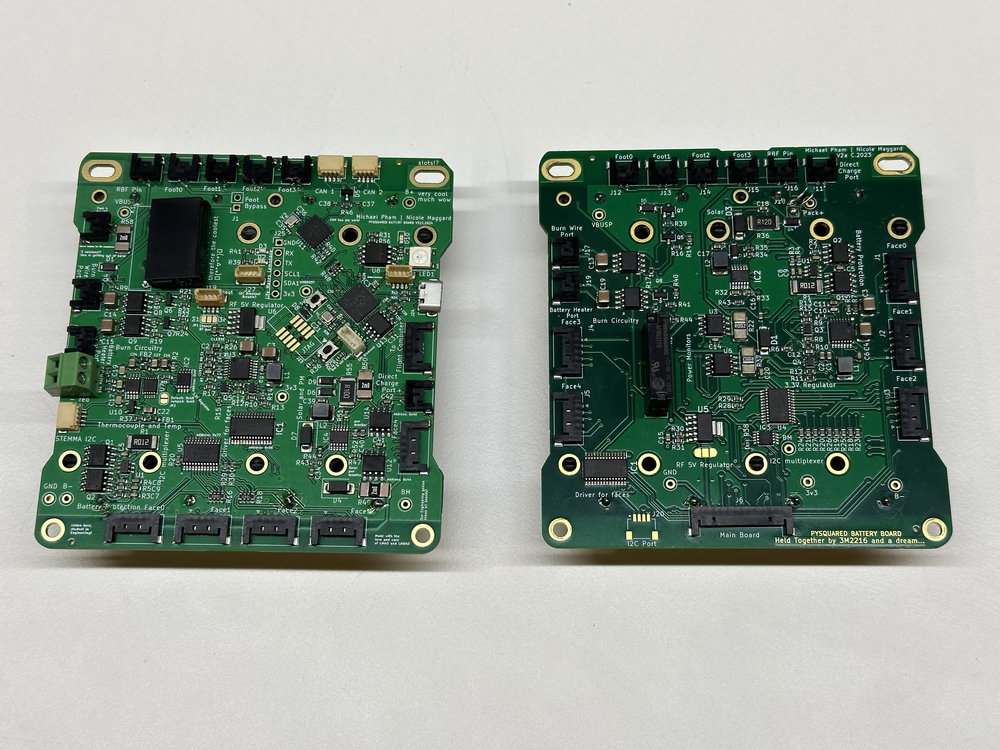

Figure 1: The Battery Board V3 (left) and V2 (right)

The PROVES Kit Battery Board was baselined on the PyCubed battery board, but has since evolved into more of a fully fledged EPS board. This is especially true of V3 and V3a which both host their own RP2040 microcontroller.  
## Getting Started
Currently there is one officially supported version of the batery board and one in development version: 

| Version |Flight Heritage| Description |
|---------|---------------|--------------------|
| **V2a** | Pleiades - Yearling 2, Pleiades - Squared | This version contains the core functionalities needed for battery and sensor management. |
| **V3**  | None| This version is a significant overhaul of the battery board, and it implements a RP2040 microcontroller for power management. |
| **V3a**  | None| Removed the multiplexer and LED driver to make way for a switching 5V regulator. |
| **V3b**  | None| More bug fixes over V3a and the first board to be colored red. |
| **V3c**  | None| Changed the thermocouple IC to an SPI chip and added a real time clock. |
 
## Functionalities

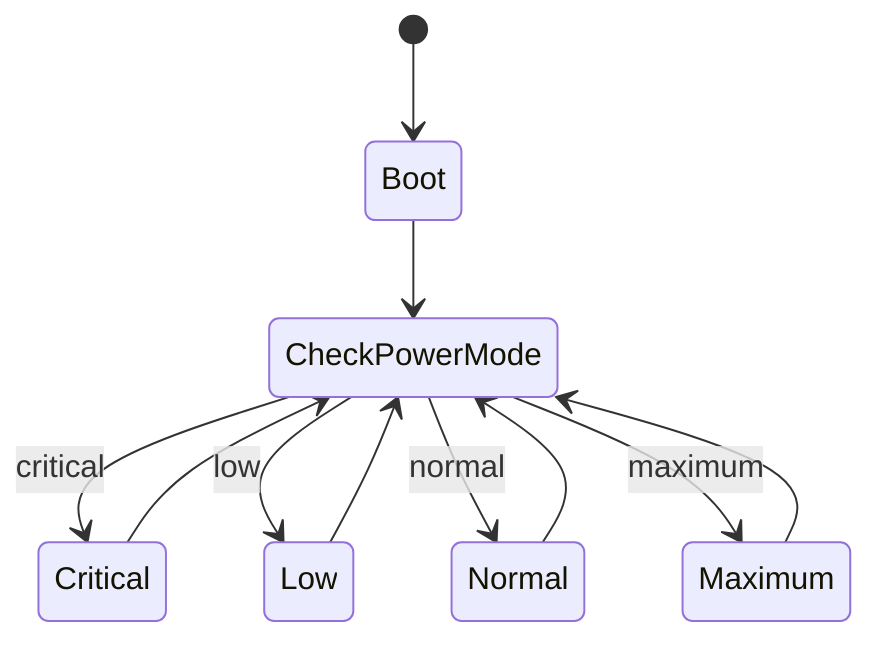

## Block Diagram
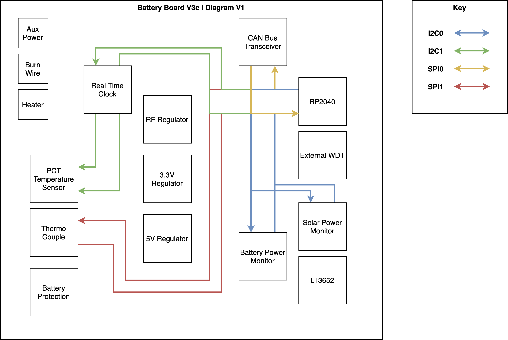

## Connectors
The board serves as an interface with the rest of the satellite.

| Connector | Count | Connects to |
| --------- | ----- | ----------- |
| 12 position Picolock | 1 | Flight Controller |
| 5 position Picolock | 5 | Solar faces |
| 2 position Picolock | 4 | Inhibit scheme, battery heater, burn wire, direct charging port |

## The Inhibit Scheme 
One of the most important functions of the battery board is to properly inhibit the satellite and ensure that no electrical power flows while it is inside the deployer pod. For this purpose, there are a set of limit switches that can be attatched to the 2pos headers on the battery board that are thrown open when inside a deployer pod to cut off battery power from the satellite. Usually the requirement is only for two inhibits in series, but we use a 2s2p configuration for redundancy. 

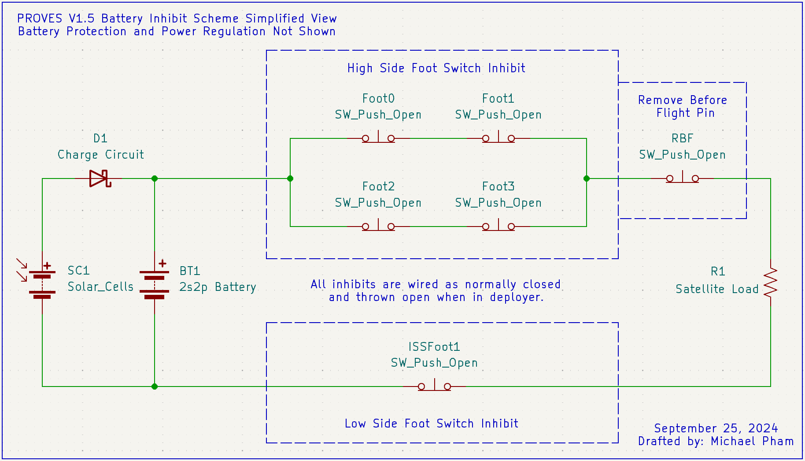

!!! warning
    V2 and earlier battery boards are not ISS compliant as there is no low side inhibit switch that fully isolates the batteries from the rest of the electrical subsystems. 

## Utilized Parts
The battery board flown on the Pleiades-Yearling and Pleiades-Squared missions uses the following hardware. Parts marked PyCubed are borrowed from Max Holliday's PyCubed.

| Function | Part | Notes | Origin |
| -------- | ---- | ----- | ------ |
| Solar charger | LT3652 | Emulates MPPT rather than implementing true MPPT. A microcontroller-managed true MPPT circuit is a future goal | |
| Solar face power switching | PCA9685 LED driver | Selectively powers each face so a faulty face can be isolated. Moved to the Z- panel in V3 | |
| I2C fan-out | TCA9548 I2C multiplexer | One flight computer bus becomes one channel per face, so identical sensor addresses coexist, and a failed sensor only takes down its own face. Moved to the Z- panel in V3 | |
| 3.3V and 5V switching regulators | TPS54226PWP, two of them | Primary supply for the microcontroller and sensors. "One Shot" regulator reset lets the power bus be reset for fault recovery. A radiation hardened part exists in the family. [Datasheet](https://www.ti.com/lit/ds/symlink/tps54226.pdf) | PyCubed |
| 5V RF LDO regulator | TPS7A4501 | Clean 5V for the radio on the flight controller. Linear, so less efficient than switching, but lower noise. A radiation hardened part exists in the family. [Datasheet](https://www.ti.com/lit/ds/symlink/tps7a45.pdf) | PyCubed |
| Power monitors | INA219 | Real-time solar input and system consumption. Extensive CubeSat flight heritage | |
| Temperature sensor | PTC2075 | Ambient temperature inside the satellite | |
| Battery protection | R5460N208AA | Disconnects the battery on overcharge or overdischarge | PyCubed |
| Relay | APAN3109 | Gates battery voltage to the heater and burn wire MOSFETs | |
| Burn wire and heater switches | NDS8434 MOSFETs | PWM from the microcontroller on the gate modulates the burn wire voltage | PyCubed |

### LT3652 Solar Charger 
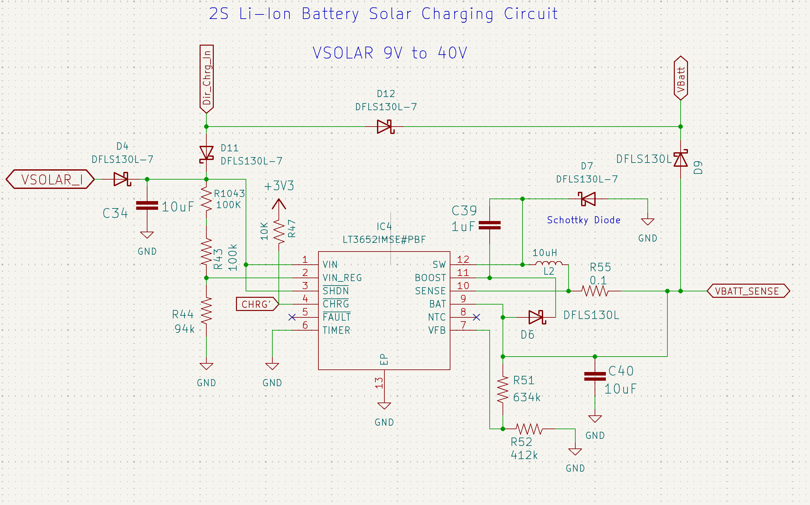

Figure 2: The LT3652 Schematic

### TPS54226PWP Switching Voltage Regulators
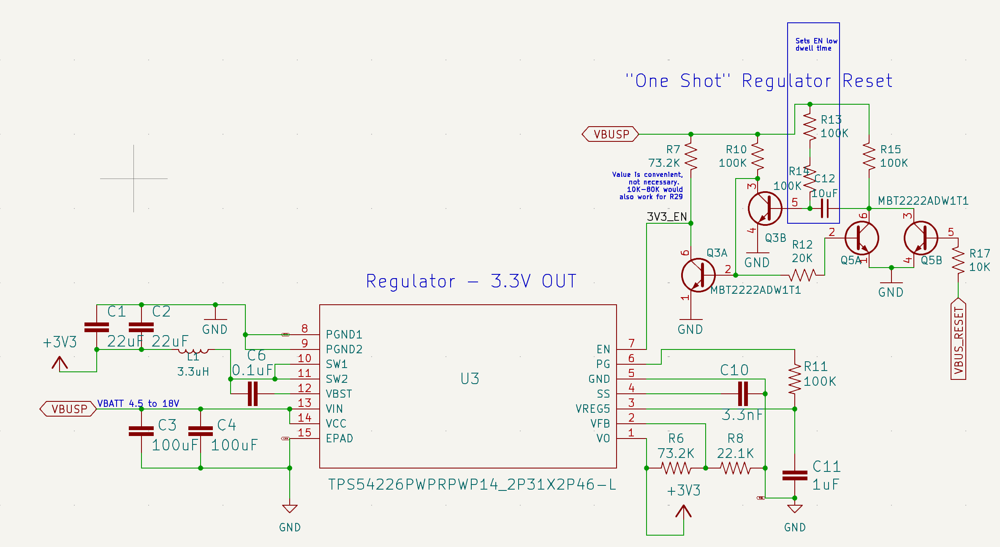

Figure 3: The 3.3V Regulator Schematic

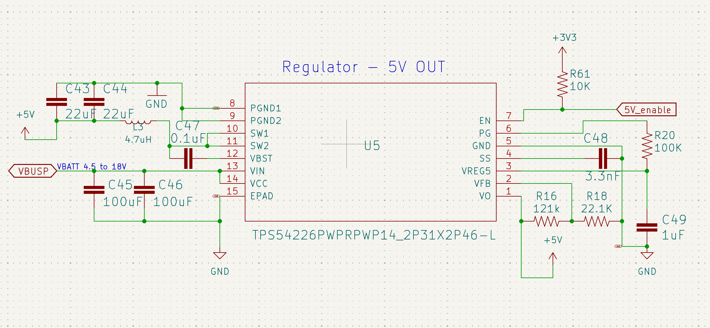

Figure 4: The 5V Switching Regulator Schematic

### TPS7A4501 LDO Voltage Regulator
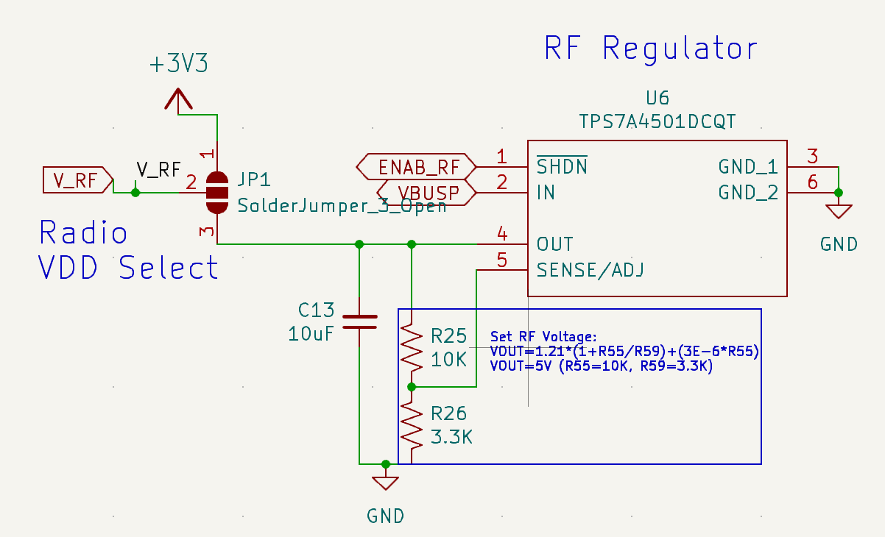

Figure 5: The 5V RF Regulator Schematic

### INA219 Power Monitors
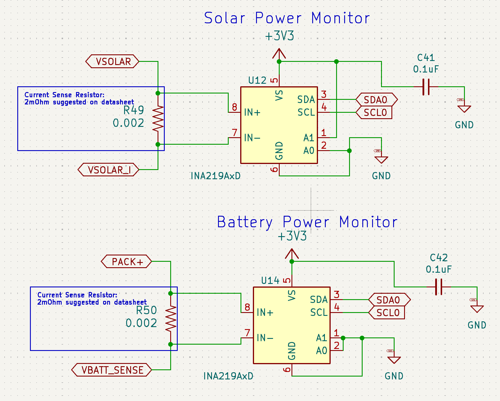

Figure 6: The INA Power Monitors Schematic

### The Burn Wire Circuit
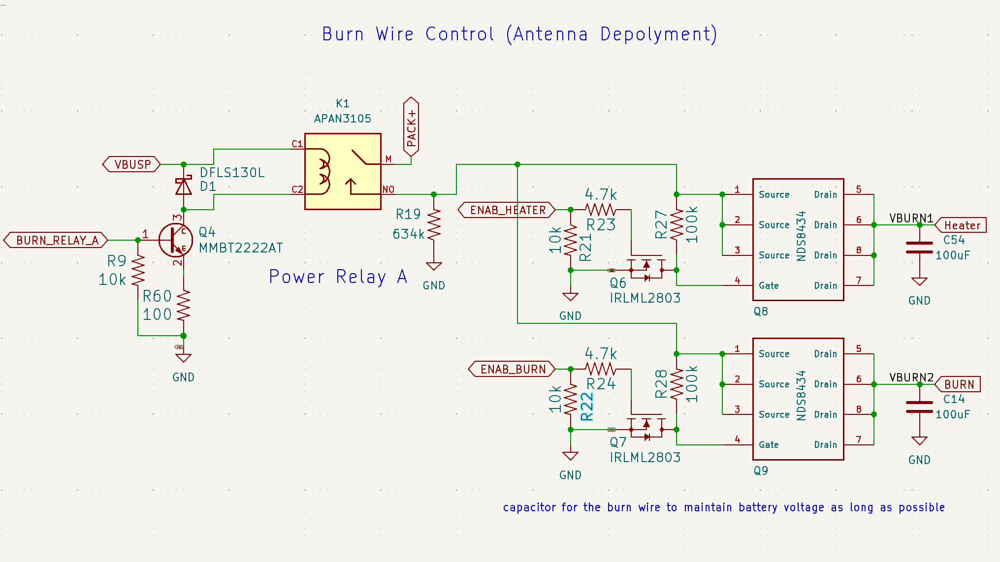

Figure 7: The Burnwire and Heater Schematic

In order to hold the antennas in a stowed position during launch we tie them off with a fishing line and use a nichrome wire to burn through that fishing line when it is time to deploy. This circuit is borrowed from Max Holliday's PyCubed. The NDS8434 MOSFETS are fed battery voltage to their sources when the APAN relay is closed and the voltage that they transmit through to the burnwire is modulated using a PWM signal from the uController fed into the gate. 

!!! bug "Burnwire Burn Through"

    If the power that flows through the NDS MOSFETs is too high the circuit will "burn through" and cause a short circuit that will trigger an overcurrent event any time battery voltage is introduced to the circuit. The attatched table from the ON Semi datasheet shows the limits.

    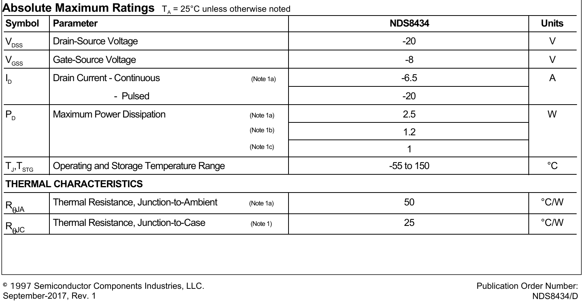

    | Parameter | Value |
    | --------- | ----- |
    | NDS8434 max drain current | 6.5 A |
    | NDS8434 max power dissipation | 1 W to 2.5 W |
    | Duty cycle needed to burn the wire | ~0.22 |
    | Assumed wire resistance | ~0.3 Ω |
    | Assumed battery voltage | 8.0 V |
    | Power through the circuit at that duty cycle | **8.53 W** |

    Way higher than what is safe. We are currently looking at changing this entire circuit out for the V4 Battery Board.

## Known Issues
1. Although the R5460N208AA is supposed to auto-release in the case of a battery protection event, it does not appear to actually do this. If you find that the satellite is not delivering power because of a battery protection event that has now been cleared, you can reset the protection circuit by "jump starting" the satellite by applying a voltage higher than the current voltage of the batteries. On-orbit these jump starts should be automatically applied by the solar charger, if they are needed. 
2. The MOSFETS in the Burn Wire and Battery Heater Circuits have much lower power carrying capacity than they should for their application. This presents a relatively high risk of "burning through" the two circuits if they get too hot, especially in vacuum. 

## Troubleshooting

*[EPS]: Electrical Power System

## Schematics
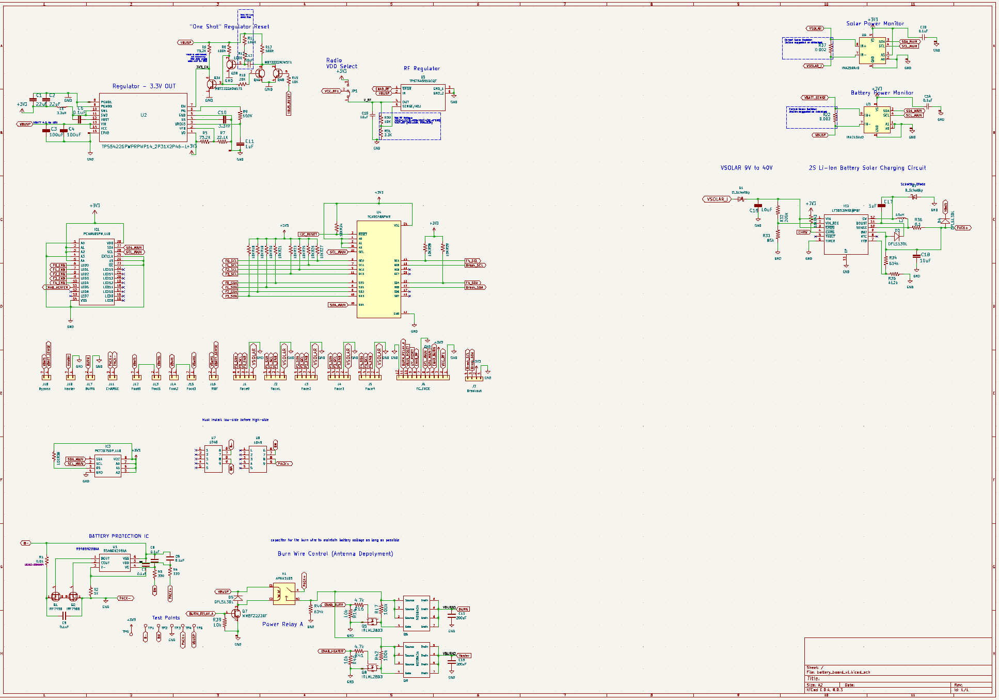

The V2 Battery Board Schematic

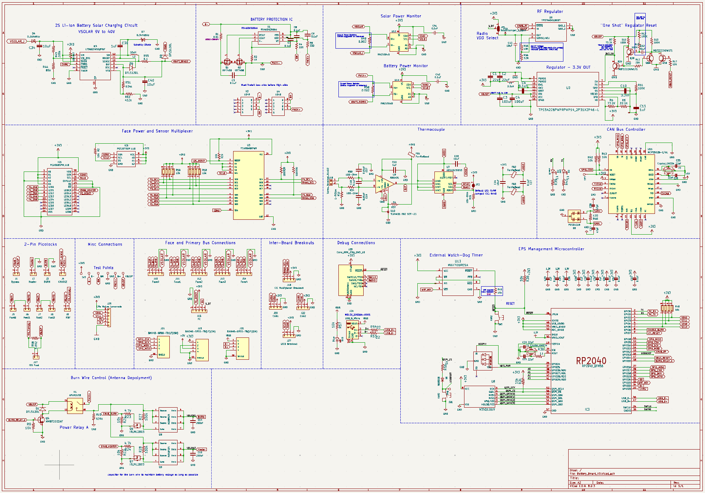

The V3 Battery Board Schematic

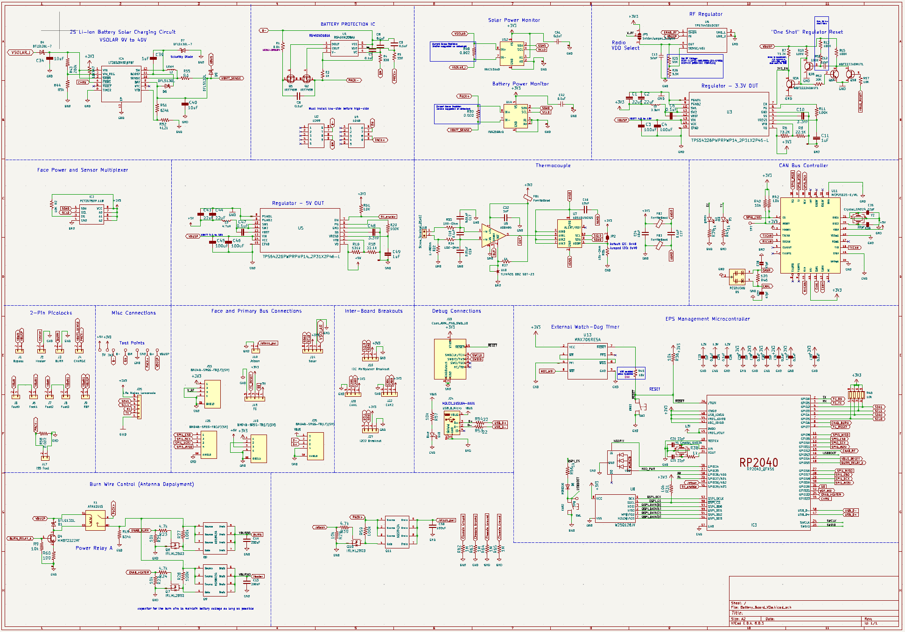

The V3a Battery Board Schematic

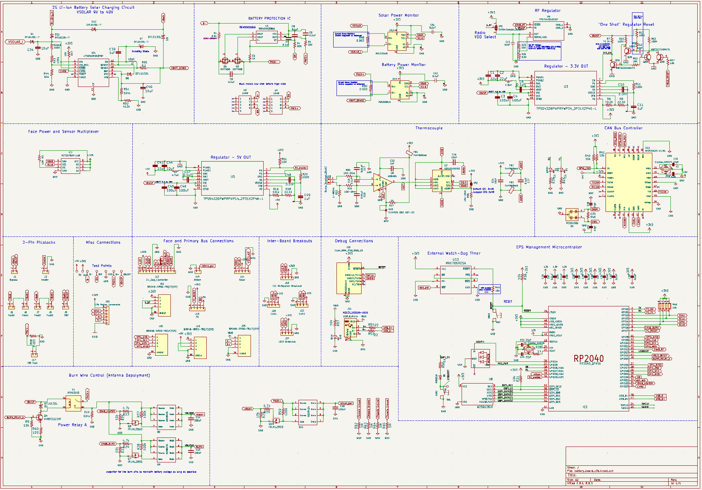

The V3b Battery Board Schematic

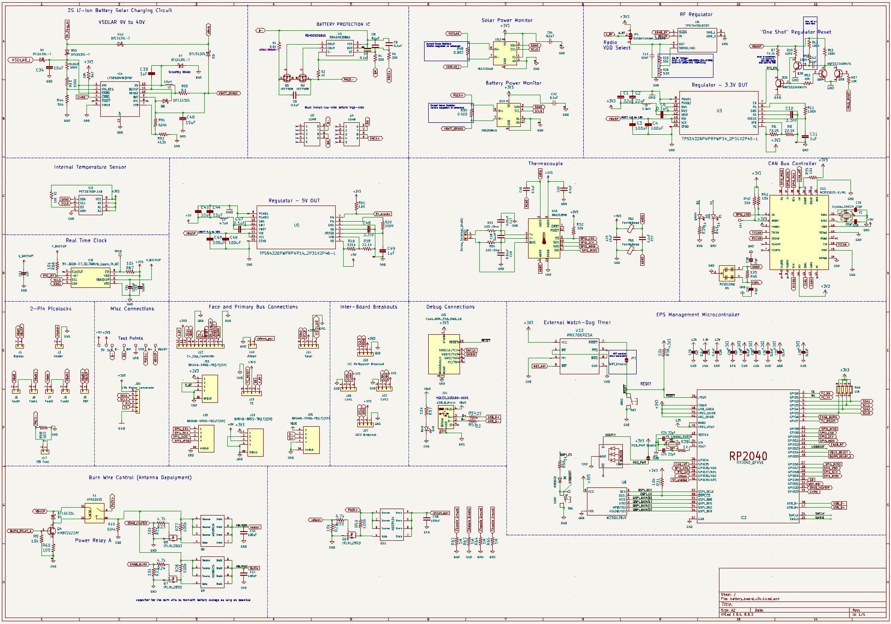

The V3c Battery Board Schematic

