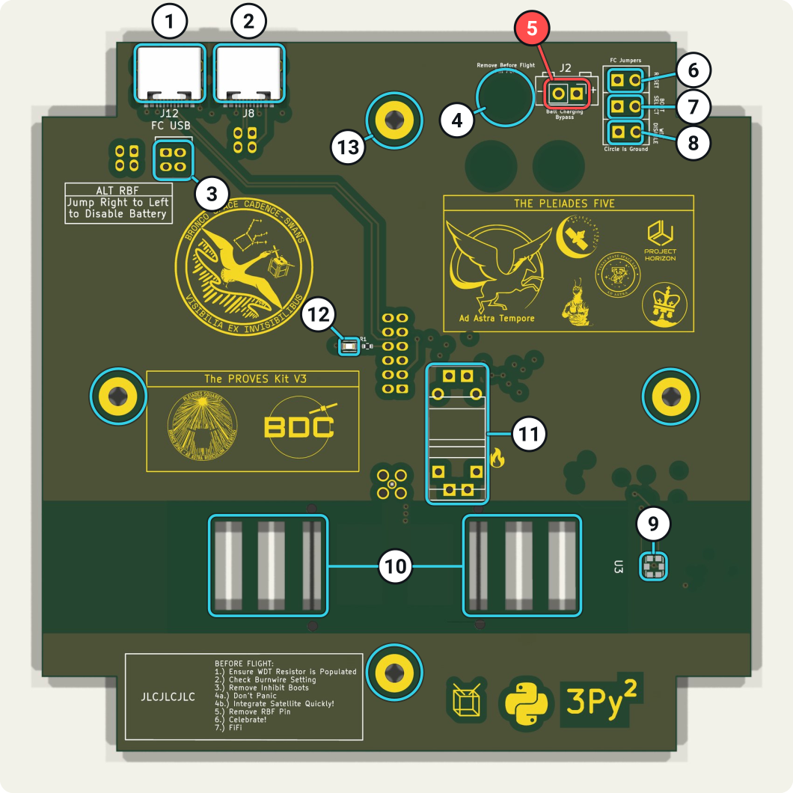
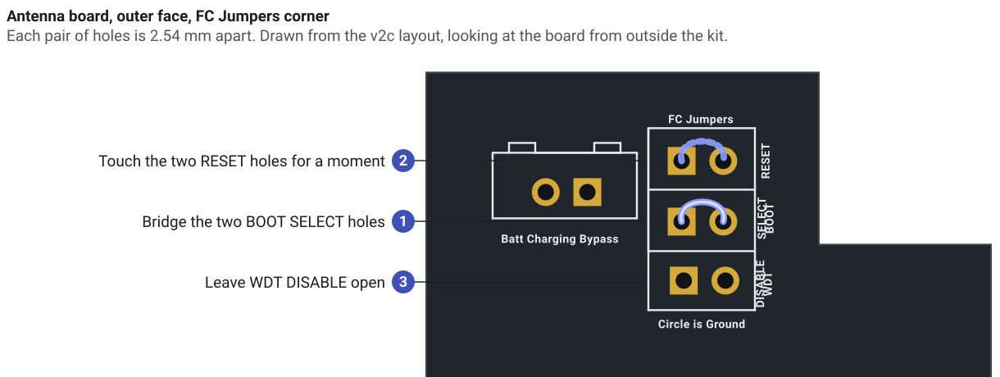

# Full kit

You have a fully assembled 1U PROVES Kit. Flight software is already on board, with a bootloader, no startup sequence, and a safe-mode latch. By the end of this page you have powered it on, listened to it, and loaded your own build with your own authentication key so that you, and only you, can command it.

Before you start, finish [Set up your development environment](../setup/dev-environment.md).

<iframe src="../../../kit-viewer/viewer.html" title="The assembled PROVES Kit in the 3D viewer" style="width: 100%; height: 50vh; border: 0; border-radius: 8px;" loading="lazy" allow="fullscreen"></iframe>

Everything you touch on an assembled kit is on the **antenna board**, the top face with the two tape-measure antennas. Press **Build** in the viewer to see how the kit goes together, or open the [build guide](../../kit-viewer/viewer.html?step=1) full screen.

## Meet the top face

This is the outer face of the antenna board, rendered from its KiCad design. The numbers match the table.



| # | Silkscreen label | What it is | What you do with it |
| - | ---------------- | ---------- | ------------------- |
| 1 | **FC USB** (J12) | A USB-C port wired to the flight controller for data only. It does not power the kit | Connect your computer here |
| 2 | J8 | A USB-C port wired to the payload connector inside the kit | Leave it empty until you fit a payload |
| 3 | **ALT RBF** | The remove-before-flight (RBF) jumper. Four plated holes in a white box. While the jumper bridges a left hole to a right hole, the batteries are disconnected | Pull the jumper to power on. Put it back to power off |
| 4 | **Remove Before Flight Pin Port** | A label left over from an older RBF pin. This board has no hole here | Nothing |
| 5 | **Batt Charging Bypass** (J2) | Two plated holes wired to the battery | Never bridge them |
| 6 | **FC Jumpers: RESET** | Two plated holes wired to the flight controller's RESET button. No pins are fitted | Bridge them to reset |
| 7 | **FC Jumpers: BOOT SELECT** | Two plated holes wired to the flight controller's BOOT button | Bridge them to enter bootloader mode |
| 8 | **FC Jumpers: WDT DISABLE** | Two plated holes that turn off the hardware watchdog while they are bridged | Leave them open, except while you load software |
| 9 | U3 | The top face light sensor | Keep it uncovered |
| 10 | | The slots where the two tape-measure antennas mount | Screw both antennas on before you power on |
| 11 | Flame mark | The burn wire that holds the antennas folded for launch | Leave it alone on the bench |
| 12 | | A blue LED on the 3.3 V supply | It glows faintly while the flight controller has power |
| 13 | | Four screws that hold the antenna board to the frame | Nothing |

The four gold pads to the left of the boxed **ALT RBF** holes, and the other bare pads on this face, are the solder joints of connectors on the inside. Do not bridge them.

The feet have deployment switches. In the deployer those switches hold the satellite off, and they do the same on your desk. Stand the kit so that no foot switch is pressed, for example on its side on a soft pad, before you expect it to power on.

## 1. Power on and listen

1. Screw both antennas on if they are not already fitted. Never let the radio transmit into nothing.
2. Stand the kit so that no foot switch is pressed.
3. Connect a USB-C cable from **FC USB** to your computer.
4. Pull the RBF jumper straight out of the **ALT RBF** holes.

<video autoplay loop muted playsinline controls poster="../../images/rbf-jumper-poster.jpg" style="width: 100%; border-radius: 8px;" aria-label="Animation of the two-pin RBF jumper lifting out of the boxed ALT RBF holes beside the FC USB port, then going back in">
  <source src="../../images/rbf-jumper.mp4" type="video/mp4">
</video>

The RBF jumper is a two-pin header with its pins soldered together. In the holes it joins the left column to the right column, which switches the batteries off. Either row works. Keep it somewhere safe, because it is also how you turn the kit off.

The kit boots on battery power. The **FC USB** port on the antenna board carries data only, so the kit does not run from USB the way a bare board does. If the batteries are flat, charge them under a bright light or take one solar face off to reach the flight controller's own USB-C port, which does power the board.

Within a few seconds a serial port appears on your computer (`ls /dev/ttyACM*` on Linux). Start the GDS on it:

```sh
cd proves-core-reference
make gds UART_DEVICE=/dev/ttyACM0
```

The connection mark flickers green and the **Channels** tab fills with real numbers: battery voltage, face temperatures, light levels, and the board's own temperature. You are listening to a satellite.

You cannot command it yet. The software on board was built in our lab with a random authentication key that you do not have. Telemetry flows down without a key. Commands need one. The next steps give the kit your key.

!!! info "Shipped in safe mode"
    Every kit ships with the flight software's safe-mode latch set. Safe mode keeps the radio and the faces powered down until a ground station says otherwise. Once your own build is on board you will exit it with a command.

## 2. Build your flight software

If you followed the setup page, you already have `bootable.uf2`, and your clone has its own `AuthDefaultKey.h`. That file is your kit's key from now on. Back it up somewhere safe and never commit it to a public repository.

If you have not built yet:

```sh
cd proves-core-reference
make
```

## 3. Put the kit into bootloader mode

The software on board will not take your commands, so you cannot ask it to reboot into the bootloader. Instead you do what the two buttons on the flight controller do, from outside the kit, through the **FC Jumpers** holes on the antenna board.

<iframe src="../../../kit-viewer/viewer.html?part=antenna-board&mark=boot-select,reset" title="The BOOT SELECT and RESET jumper holes on the antenna board, in the PROVES Kit 3D viewer" style="width: 100%; height: 50vh; border: 0; border-radius: 8px;" loading="lazy" allow="fullscreen"></iframe>



The holes have no header pins. Straighten two paper clips and bend the end of each into a U that spans 2.54 mm, or use two pairs of tweezers.

!!! danger "Stay off the Batt Charging Bypass holes"
    The pair of holes marked **Batt Charging Bypass**, next to the FC Jumpers box, is wired to the battery. A paper clip across that pair shorts the battery pack. Touch only the holes inside the **FC Jumpers** box.

With the kit powered on and connected:

1. Hold one clip in the two **BOOT SELECT** holes. Keep it there.
2. Touch the second clip across the two **RESET** holes for a moment, then take it away.
3. Take the clip out of **BOOT SELECT**.

A drive called `RP2350` appears on your computer. The flight controller inside is now in bootloader mode. If the drive does not appear, the clip left **BOOT SELECT** before the reset finished. Try again and hold it a moment longer.

!!! warning "You have about 42 seconds"
    The flight controller has a hardware watchdog. When the flight software runs it pets the watchdog every second. In bootloader mode nothing pets it, and about 42 seconds after the reset the watchdog power-cycles the flight controller. The `RP2350` drive disappears.

    Every kit ships with the watchdog wired in, so expect this. Have `bootable.uf2` ready in a terminal before you reset, and copy it as soon as the drive appears. The copy takes a few seconds. If the window closes in the middle of a copy, the kit may not start until you copy again. Enter bootloader mode again and repeat the copy. The bootloader is in the chip and cannot be erased this way.

    If 42 seconds is not enough, a third clip across the two **WDT DISABLE** holes stops the watchdog for as long as it stays in. Take it out as soon as the copy finishes.

!!! tip "The command-line way, once the kit is yours"
    After your own build is on board, the GDS command `ReferenceDeployment.bootloaderTrigger.TRIGGER_BOOTLOADER` reboots the kit into bootloader mode without touching the jumpers. Raspberry Pi's `picotool reboot -f -u` does not work on a kit running the flight software, because the flight software does not expose the reset interface picotool looks for. Use the jumpers the first time.

## 4. Load your build

Copy your build to the drive. Replace the path with where `RP2350` mounted.

```sh
cp bootable.uf2 /media/$USER/RP2350/
```

The drive disappears and the kit reboots into your software. The bootloader on board accepts your build because both use the same signing key, so you do not install MCUboot again.

## 5. Take command

Start the GDS and sync the sequence number:

```sh
make gds UART_DEVICE=/dev/ttyACM0
```

In a second terminal:

```sh
make sync-sequence-number
```

Now send commands from the **Commanding** tab:

1. `CdhCore.cmdDisp.CMD_NO_OP`. The events `OpCodeDispatched` and `NoOpReceived` appear. Your key works.
2. `ReferenceDeployment.modeManager.GET_CURRENT_MODE`. It reports safe mode.
3. `ReferenceDeployment.modeManager.EXIT_SAFE_MODE`. The faces power up and more telemetry channels come alive.

From here the kit is yours. The [radio stick](radio-stick.md) path puts the same commands over the air.

## Power off and handling

- To power off, put the RBF jumper back in. Unplug USB after that, not before, if you want the board to go dark at once.
- Put the RBF jumper in and disconnect the batteries before you unplug any solar face.
- The kit charges its batteries from the solar faces under bright light. Indoor light is not enough to matter.
- Keep the **WDT DISABLE** holes open in normal use. The flight software pets the hardware watchdog for you. The one time to bridge them is while you load software in bootloader mode.

## Next step

- Read the [ModeManager](https://open-source-space-foundation.github.io/proves-core-reference/) design document to learn what safe mode protects.
- Read the [assembly guide](../../assembly_guide/introduction.md) to learn what is inside, even if you never open it.
- Plan your first range test with the [radio stick](radio-stick.md).
