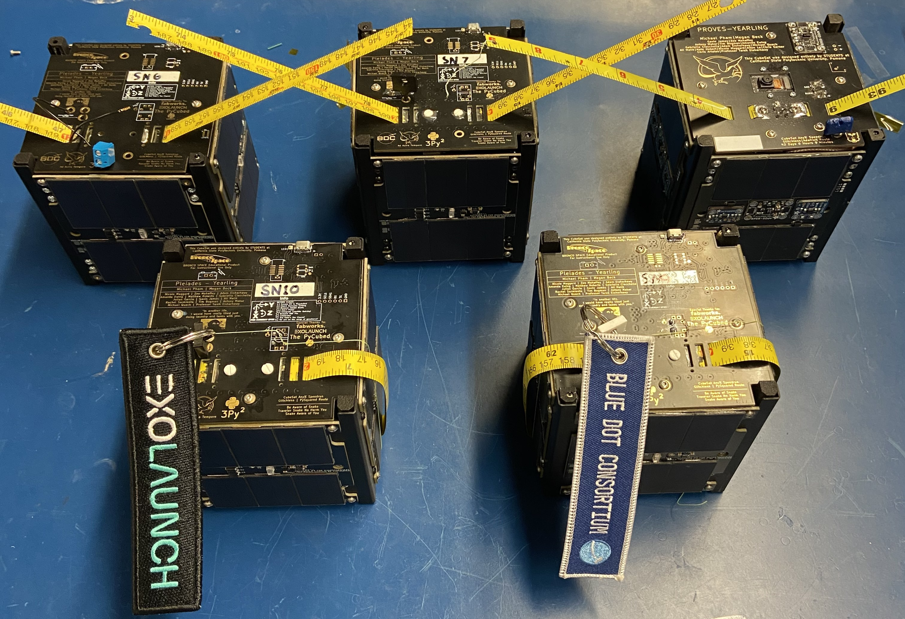
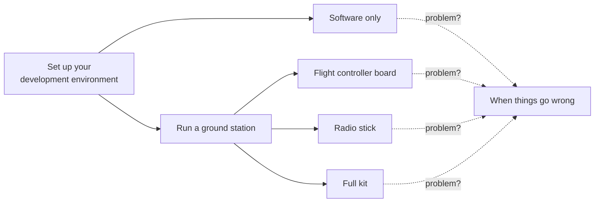

# So You Have a PROVES Kit!

The Pleiades - Yearling Fleet

Welcome aboard. This guide takes you from "the box just arrived" to "I sent my first command to a satellite." It is written for university students who can use a computer but have not built embedded software before. If a word is new, look for the short definition in the text or in the [glossary](#glossary) at the bottom.

## Pick your path

Not everyone receives the same hardware. Find the row that matches what you have and follow that path. Each path tells you which shared setup pages to read first.

-   :material-laptop:{ .lg .middle } __Software only__

    ---

    You have no hardware yet. You want to clone the flight software, build it, run its tests, and learn how the project is put together.

    [:octicons-arrow-right-24: Software only](paths/software-only.md)

-   :material-chip:{ .lg .middle } __A flight controller board__

    ---

    You have a V5e Flight Controller Board on its own. You want to build the flight software, load it onto the board, and send commands from a ground station.

    [:octicons-arrow-right-24: Flight controller board](paths/flight-controller.md)

-   :material-usb-flash-drive:{ .lg .middle } __A PROVES Radio Stick__

    ---

    You have the USB radio stick. You want to set it up as a ground radio so you can talk to a kit over LoRa.

    [:octicons-arrow-right-24: Radio stick](paths/radio-stick.md)

-   :material-cube-outline:{ .lg .middle } __A fully assembled kit__

    ---

    You have a complete 1U CubeSat with software already on board. You want to power it on, listen to it, and then load your own build with your own security key.

    [:octicons-arrow-right-24: Full kit](paths/full-kit.md)

## What every path has in common

All four paths use the same flight software, [proves-core-reference](https://github.com/Open-Source-Space-Foundation/proves-core-reference). It is built on two open source projects:

- [F Prime](https://fprime.jpl.nasa.gov/), a flight software framework from NASA's Jet Propulsion Laboratory. F Prime gives us components, commands, telemetry, events, and a ground station.
- [Zephyr](https://www.zephyrproject.org/), a real-time operating system that runs on the RP2350 microcontroller on the flight controller board.

You do not need to understand either one to finish this guide. You run `make`, and the project downloads and configures both for you.

### Pick a computer

The project is developed and tested on Linux and macOS. Pick one of these if you can:

- A Linux laptop or desktop running a recent Ubuntu or Debian.
- A Mac with Apple Silicon or Intel.
- A Raspberry Pi 500 or Pi 5 with 8 GB of RAM running Raspberry Pi OS (64-bit). This is our recommended lab setup. It is cheap, it stays at the bench, and every student can use the same one.

!!! warning "Windows is at your own risk"
    F Prime does not officially support Windows, and neither do we. If Windows is all you have, install Windows Subsystem for Linux (WSL2) with Ubuntu and follow the Linux instructions inside it. Reaching a USB board from WSL2 takes extra steps, which the [development environment](setup/dev-environment.md) page covers. Expect rough edges.

### Let an AI agent help you

Setting up a toolchain is the part of embedded development where an AI coding agent helps most. An agent such as [Claude Code](https://claude.com/claude-code) can read the error on your screen, read the Makefile, and tell you what to run next.

Two things make this work better:

1. Open the agent inside your clone of `proves-core-reference`. The repository has an `AGENTS.md` file that explains the build to the agent.
2. Install Matt Pocock's [Wizard skill](https://github.com/mattpocock/skills). It turns a long setup into an interactive checklist that walks you through the steps only a human can do, such as plugging in the board or approving an install.

Ask the agent to explain each command before it runs it. The goal is that you understand your own development environment by the end.

## Where to go next

1. Read [Set up your development environment](setup/dev-environment.md). Every path needs it.
2. If you have hardware, read [Run a ground station](setup/ground-station.md).
3. Follow your path from the cards above.
4. When something does not work, check [When things go wrong](setup/troubleshooting.md).

If your kit still runs the older CircuitPython software, the [legacy CircuitPython quick start](legacy_circuitpython_quick_start.md) is the page you want.

## Glossary

| Term | Meaning | In this guide |
| ---- | ------- | ------------- |
| **Bootloader** | A small program that runs first when the board powers on. It checks that the flight software is signed with the right key, then starts it | MCUboot |
| **Build** | Turning the source code into a file the board can run | The result is `bootable.uf2` |
| **Flash** (verb) | Copying a built program onto the board | Copy `bootable.uf2` to the `RP2350` drive |
| **GDS** | The F Prime Ground Data System. A web page on your computer that shows telemetry and lets you send commands | `make gds` |
| **Repository** (repo) | A folder of source code tracked by Git, usually hosted on GitHub | `proves-core-reference` |
| **Telemetry** | Measurements the satellite sends down, such as battery voltage and temperatures | The **Channels** tab in the GDS |
| **Toolchain** | The compilers and tools that turn source code into a program for the board | `make` installs ours |
| **UF2** | A file format the RP2350 bootloader accepts. You copy a `.uf2` file to the board like you copy a file to a USB drive | `bootable.uf2`, `mcuboot.uf2` |
| **YAMCS** | Yet Another Mission Control System. An alternative to the GDS with a web interface built for mission operations | `make yamcs` |

*[RP2350]: The Raspberry Pi microcontroller on the V5e flight controller board
*[LoRa]: A long-range, low-power radio modulation
